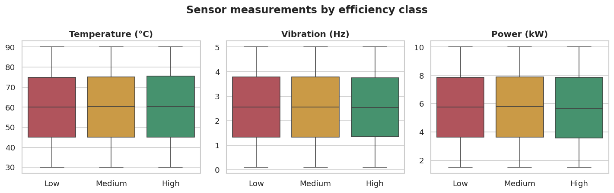
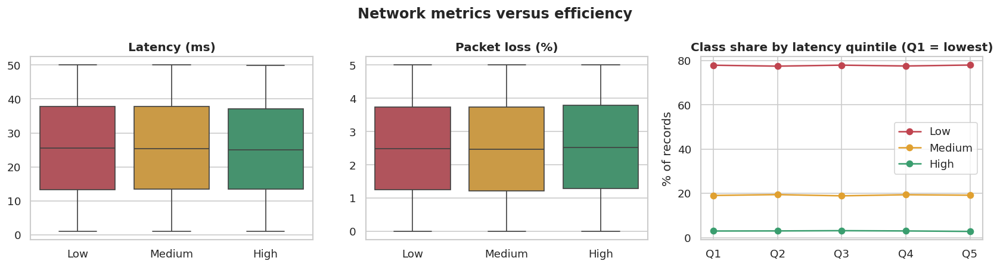
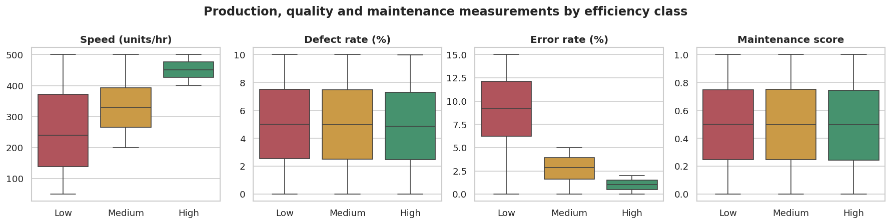
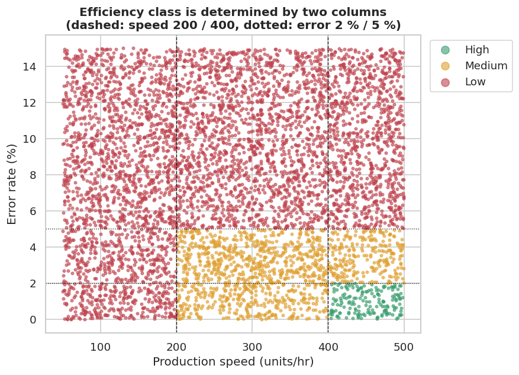
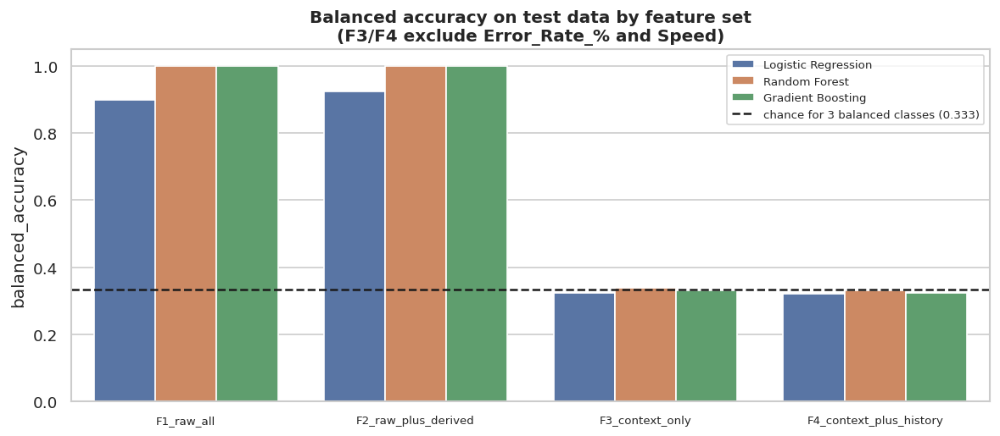
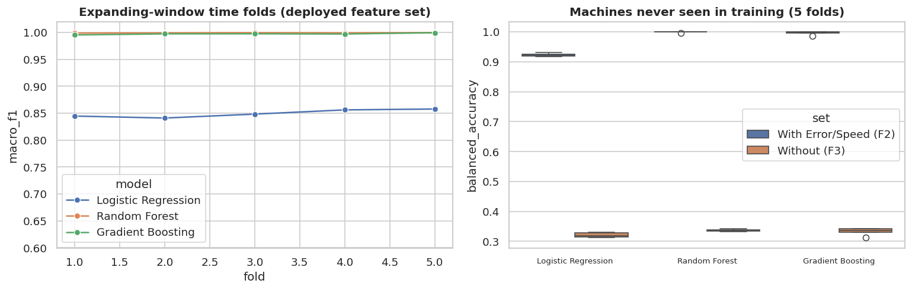
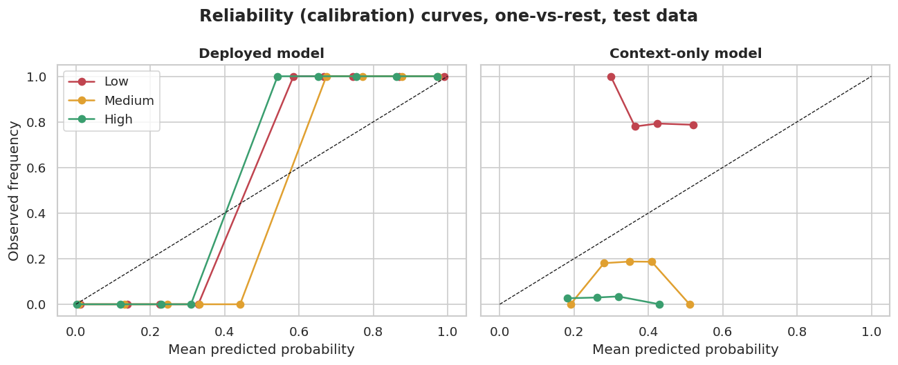
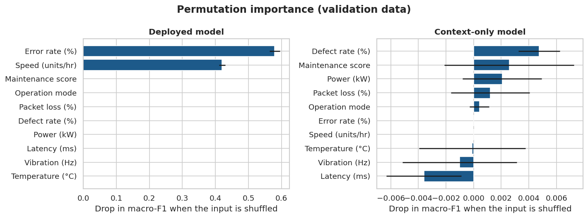
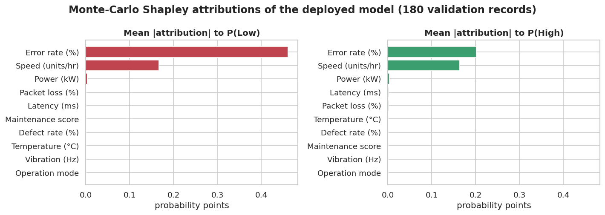

# AI-Based Manufacturing Efficiency Classification Using Sensor, Production, and 6G Network Data

*Domain: Artificial Intelligence · Machine Learning · Smart Manufacturing · Industrial IoT · Network Analytics*

> **Scope statement.** The project brief names Unified Mentor and Thales Group. This work does **not** claim approval, endorsement or deployment by either organisation.
> All numbers in this paper are generated from the supplied file `Thales_Group_Manufacturing.csv` by the code in this repository (`python -m src.train_models`, then `python -m src.report_builder`).

---

## 1. Title
AI-Based Manufacturing Efficiency Classification Using Sensor, Production, and 6G Network Data

## 2. Abstract
We analysed 100,000 one-minute records from 50 machines (temperature, vibration, power, network latency, packet loss, defect rate, production speed, maintenance score, error rate, operation mode)
and trained models to classify the observed efficiency state as High, Medium or Low. The classes are strongly imbalanced (Low 77.8%, Medium 19.2%, High 3.0%).
**The audit shows that the label is a deterministic rule of two columns:** High = error rate ≤ 2 % and speed > 400 units/hr; Medium = error rate ≤ 5 % and speed > 200; otherwise Low. The rule matches 99.998% of records.
Consequently, models that receive those two columns reach a test macro-F1 of 1.0000 (Random Forest, chronological test set of 15,000 records),
but this demonstrates *recovery of a labelling rule*, not prediction of efficiency from sensors or network conditions.
When the two columns are withheld, all three algorithms (Logistic Regression, Random Forest, Gradient Boosting) fall to chance level (best test balanced accuracy 0.338 versus 0.333 expected by chance),
with and without past-only history features, and also for machines never seen in training. Network latency, packet loss, temperature, vibration, power, defect rate, maintenance score and operation mode
show no association with efficiency (numeric measurements: all Kruskal-Wallis p ≥ 0.16, eta-squared ≤ 3.7e-05; operation mode: chi-square p = 0.47). We provide a Streamlit dashboard with prediction, probabilities, explanations,
machine-level views and a clearly labelled *simulated* live replay. The results do not show that the system can predict future breakdowns.

## 3. Introduction
Smart factories combine Industrial IoT sensors with low-latency wireless links (Lee et al., 2015; Saad et al., 2020). Dashboards typically describe what has already happened.
Machine learning can classify the current state automatically, but its value depends on whether the label reflects an independently measured outcome and whether the input data really carry information about it.
This paper builds a classifier for High/Medium/Low efficiency and, equally importantly, tests what that classifier has actually learned.

## 4. Background and context
Manufacturing efficiency can fluctuate with sensor deviations, network instability, quality and error changes, speed changes and operating conditions. Network metrics (latency, packet loss) are of interest because
unreliable connectivity may delay control signals or data. Whether such effects exist in a given plant is an empirical question; in this dataset it is tested directly (sections 9 and 15).
Evaluation of time-ordered data requires chronological splitting (Bergmeir & Benítez, 2012), and label leakage is a well-documented cause of over-optimistic results (Kaufman et al., 2012; Kapoor & Narayanan, 2023).

## 5. Problem statement
Manufacturing teams face delayed detection of efficiency degradation, manual interpretation of many metrics, a lack of automated and interpretable assessment, and possible production losses from delayed action.
The goal is a machine-learning solution that analyses measurements, predicts the efficiency class, shows confidence, and explains influential factors.

## 6. Research objectives
1. Audit the dataset (structure, quality, timeline, relationships, outliers).
2. Build a reproducible preprocessing and feature-engineering pipeline without leakage.
3. Compare Logistic Regression, Random Forest and Gradient Boosting under identical chronological evaluation, with class-imbalance handling.
4. Quantify the contribution of sensor, network, production and quality measurements, including whether the label can be predicted *without* the label-defining columns.
5. Provide global and local explanations, calibrated-confidence discussion, and an interactive dashboard.
6. State clearly what the results do and do not show.

## 7. Dataset description
| Property | Value |
|---|---|
| File | `Thales_Group_Manufacturing.csv` (verified from the file; the brief's schema was not assumed) |
| Rows × columns | 100,000 × 14 (matches the 14 expected columns: True) |
| Period | 2025-01-01 00:00:00 to 2025-03-10 10:39:00 (1 record per minute) |
| Machines | 50 (IDs 1-50); 1,906-2,092 records each |
| Operation modes | Active 70,054, Idle 20,057, Maintenance 9,889 |
| Missing values / duplicate rows | 0 / 0 |
| Target | `Efficiency_Status` |

| Class | Records | Share |
|---|---|---|
| Low | 77825 | 77.83% |
| Medium | 19189 | 19.19% |
| High | 2986 | 2.99% |

**Data-quality findings.**
* *Uniform, independent measurements.* Every numeric column is distributed almost exactly uniformly between fixed limits (largest Kolmogorov-Smirnov distance to a uniform distribution 0.0048), and the largest absolute correlation between any two measurements is 0.008. Real sensor streams are rarely like this; the data appear simulated.
* *Outliers.* There are no IQR outliers and no values outside plausible physical limits (0 and 0).
* *Timeline anomaly.* File order follows one-minute steps except at row 86400, where the clock jumps back 1439 minutes. As a result the date label `01-03-2025` carries 2,880 records (two days) and 1,440 timestamps occur twice. A likely explanation is that a non-existent date (29-02-2025; 2025 is not a leap year) was rolled over to 01-03-2025 by the data generator. This is a hypothesis, not a proven fact.
* *Sparse machine histories.* Each minute holds one record from a randomly different machine, so the median gap between two records of the same machine is 35 minutes (mean 50).

## 8. Data cleaning and preprocessing
| step | detail |
|---|---|
| duplicates | Removed exact duplicate rows (all 14 columns equal) |
| categories | Operation_Mode / Efficiency_Status stripped + title-cased; unexpected categories -> missing |
| numeric validation | Non-numeric or physically impossible values set to missing (imputed with TRAIN medians inside the pipeline) |
| label check | Rows without a valid Efficiency_Status removed |
| ordering | Sorted by file order (verified to be one-minute steps); the recorded Date label is kept for display. Two-day block labelled 01-03-2025 is NOT altered. |

* No missing values, duplicates or invalid values were found, but the code handles them: duplicates are removed only when all 14 columns are identical; impossible or non-numeric values become missing and are imputed with **training** medians inside the pipeline; unexpected `Operation_Mode` categories are encoded as "no mode" (all-zero one-hot) and flagged in the dashboard.
* `Date` + `Timestamp` were combined into a datetime (format dd-mm-YYYY HH:MM:SS). Because of the timeline anomaly, ordering, splitting and history features use **file order**, which the audit verified to be chronological; the recorded date is retained for display.
* `Machine_ID` is preserved for filtering but is **not** a model input (an identifier would not generalise to new machines).
* `Operation_Mode` is one-hot encoded with fixed categories; numeric features are median-imputed, and standardised **only** for Logistic Regression (tree ensembles do not need scaling).
* The preprocessor is fitted on the training period only and saved (`models/preprocessor.joblib`); the dashboard applies the same object. A test confirms that the scaler's mean equals the training mean and not the full-data mean.

## 9. Exploratory data analysis
### 9.1 Class balance
Figure `outputs/figures/01_class_distribution.png`. High records are rare (2,986 of 100,000); accuracy alone would be misleading (always predicting Low gives 78.2% accuracy on the test period but a balanced accuracy of 0.333).

### 9.2 Sensors (temperature, vibration, power)


Mean temperature, vibration and power are practically identical across classes (see table below; standardised High−Low differences of 0.013 SD at most).

| Measurement | Low | Medium | High | (High-Low)/SD |
|---|---|---|---|---|
| Temperature (°C) | 60.006 | 60.154 | 60.232 | 0.013 |
| Vibration (Hz) | 2.550 | 2.552 | 2.548 | -0.001 |
| Power (kW) | 5.743 | 5.762 | 5.718 | -0.010 |
| Latency (ms) | 25.562 | 25.566 | 25.334 | -0.016 |
| Packet loss (%) | 2.494 | 2.487 | 2.528 | 0.023 |
| Defect rate (%) | 5.017 | 4.989 | 4.930 | -0.030 |
| Speed (units/hr) | 254.854 | 334.125 | 450.791 | 1.506 |
| Maintenance score | 0.500 | 0.498 | 0.495 | -0.017 |
| Error rate (%) | 8.930 | 2.733 | 1.007 | -1.827 |

### 9.3 Network


Class shares by latency quintile range only from 77.5% to 78.0% Low and 2.79% to 3.13% High: no gradient. By network-quality band (tertiles of a latency + packet-loss index):

| Network quality | Low | Medium | High |
|---|---|---|---|
| Good | 77.84 | 19.15 | 3.01 |
| Fair | 77.75 | 19.33 | 2.92 |
| Poor | 77.88 | 19.09 | 3.03 |

(percentage of records in each class; `outputs/figures/11_efficiency_by_network_quality.png`).

### 9.4 Production, quality and maintenance


Only production speed and error rate differ between classes (Error rate (%): mean 8.93 (Low), 2.73 (Medium), 1.01 (High); Speed (units/hr): mean 254.85 (Low), 334.13 (Medium), 450.79 (High)). Defect rate and maintenance score do not.
Power versus production speed has a correlation of 0.002 (`05_power_vs_speed.png`): in this data power does not rise with output.



The scatter plot of speed against error rate shows the classes as rectangular regions bounded by speed 200/400 and error rate 2 %/5 %.

### 9.5 Statistical association of every measurement with the class
| Measurement | Kruskal-Wallis p | Eta-squared | Mutual information |
|---|---|---|---|
| Temperature (°C) | 0.474 | 1.5e-05 | 0.0017 |
| Vibration (Hz) | 0.984 | 3.1e-07 | 0.0014 |
| Power (kW) | 0.517 | 1.3e-05 | 0.0010 |
| Latency (ms) | 0.684 | 7.6e-06 | 0.0035 |
| Packet loss (%) | 0.345 | 2.1e-05 | 0.0000 |
| Defect rate (%) | 0.158 | 3.7e-05 | 0.0034 |
| Speed (units/hr) | < 0.0001 | 0.1128 | 0.1393 |
| Maintenance score | 0.549 | 1.2e-05 | 0.0036 |
| Error rate (%) | < 0.0001 | 0.3836 | 0.3540 |

Production speed and error rate are the only measurements with a non-negligible relationship (eta-squared 0.113 and 0.384).
For the other seven measurements eta-squared is at most 3.7e-05 (essentially zero) and the smallest Kruskal-Wallis p-value is 0.158. With 7 tests, a smallest p of 0.158 is entirely unremarkable.

### 9.6 Machines, operation modes and time
* **Operation mode:** Low share Active 77.7%, Idle 78.3%, Maintenance 77.8%; chi-square p = 0.465 (no difference).
* **Machines:** Low share per machine ranges from 76.1% to 80.4% (fleet 77.8%). Using 95% Wilson intervals, 2 machines are distinguishable above and 0 below the fleet average (with 50 machines, about 2.5 intervals are expected to exclude the fleet value by chance alone); the chi-square test of machine versus class gives p = 0.711, i.e. no evidence of machine-level differences beyond chance (`08_machine_low_share.png`).
* **Time:** weekly Low share ranges from 77.3% to 78.6%; chi-square p = 0.156. No degradation period is visible (`09_efficiency_over_time.png`).

## 10. Feature engineering
| Set | Numeric features | Categorical | Description |
|---|---|---|---|
| F1_raw_all | 9 | 1 | All 9 raw measurements + Operation_Mode (includes the two label-defining columns). |
| F2_raw_plus_derived | 12 | 1 | F1 + single-observation derived features (energy per unit, error-to-speed ratio, network stress index). DEPLOYED set. |
| F3_context_only | 8 | 1 | Sensors + network + defect rate + maintenance score + mode; WITHOUT Error_Rate_% and Production_Speed (tests the sensor/6G premise). |
| F4_context_plus_history | 28 | 1 | F3 + past-only rolling statistics of the same machine (incl. previous Error_Rate_% / Speed) + time-of-day features. |
| F5_rule_inputs_only | 2 | 0 | ONLY Error_Rate_% and Production_Speed (shows these two columns are sufficient). |

Implemented and kept: *energy per unit* (power ÷ speed), *error-to-speed ratio*, and a *network stress index* (standardised latency + standardised packet loss, reference mean/SD fitted on training data; tertiles define Good/Fair/Poor).
Zero denominators return missing values rather than infinity.
Evaluated and **excluded from the deployed model** (set F4): past-only rolling means and standard deviations (window of the previous 5 records of the same machine, a record-based window because records of one machine are ~35 minutes apart) of eight measurements, the speed change between the two previous records, minutes since the previous record, hour of day and day of week.
They gave no benefit (section 15), they cannot be computed for a single manually entered observation, and the audit found no time structure, so they are not justified by the data.

## 11. Methodology
* **Chronological split** (no shuffling): training 70,000 records (2025-01-01 to 2025-02-18), validation 15,000 (2025-02-18 to 2025-03-01), test 15,000 (2025-03-01 to 2025-03-10). Because of the repeated date label, "periods" are defined by file order.
* All models and preprocessors are fitted on training data only; the final model is chosen from **validation** results; test results are reported afterwards.
* **Three evaluation set-ups, each measuring something different:** (i) the chronological test set measures performance on *later* records of the same machines; (ii) five expanding-window time folds on the first 85% measure stability over time; (iii) five folds in which 10 machines are withheld from training and evaluation uses the *test period* records of those machines measure transfer to unseen machines. None of them measures prediction of future *events* such as breakdowns, because the label describes the *current* observed state.
* **Experiment grid:** 3 algorithms × 4 feature sets (F1-F4) × 2 class-weight settings, plus a depth-4 decision tree on the two label-defining columns (F5) and an always-Low baseline.
* Selection rule (recorded in the model metadata): highest validation macro-F1 on F2_raw_plus_derived; models within 0.001 of the best are tied and ranked by High-class F1, then training time.

## 12. Machine-learning models
| Model | Configuration |
|---|---|
| Logistic Regression | multinomial, L2 (C = 1), standardised inputs, max 3,000 iterations |
| Random Forest | 100 trees, max depth 12, min leaf 5, `balanced_subsample` weights when weighted |
| Gradient Boosting | scikit-learn `HistGradientBoostingClassifier`, 150 iterations, learning rate 0.1 (XGBoost was not used; it is optional in the brief and was not installed in the build environment) |

## 13. Data-leakage prevention
**Finding.** `Efficiency_Status` is derived from `Error_Rate_%` and `Production_Speed_units_per_hr`: a depth-4 tree on only these two columns scores 100.0% on the later 30% of the data, while a tree on the other seven measurements plus mode scores 77.78% (majority class: 77.79%).
The explicit rule agrees with 99.998% of records; the 2 exceptions have an error rate displayed as exactly 5.000, consistent with rounding of stored values.

Because the label is a function of two *input* columns, supplying them to a model is not "using the target" in the strict sense, but it makes the task trivial. We therefore (a) report results both with and without those columns,
(b) label the deployed model accordingly, and (c) never claim that its score demonstrates predictive power from sensors or the network.

**Safeguards.** The target is never an input; the split is chronological; imputer, scaler, encoder and network-reference statistics are fitted on training rows only; no resampling is used before splitting (none was used at all);
history features use `shift(1)` before rolling windows and never the current or future rows, which is **tested** by changing a single row and confirming that its own history features are unchanged while the same machine's next record does change;
`Machine_ID` is not a feature; derived features use only the same record.
*Development note:* an earlier draft of a "speed change" feature subtracted the previous speed from the **current** speed. That leaked a label-defining column: in the no-signal feature set one model's validation balanced accuracy rose above chance (about 0.49). It was detected from that anomaly, replaced by the change between the two *previous* records, and the stricter single-row test above was added. All reported results use the corrected feature.

## 14. Class-imbalance handling
High is 3.0% of the data. We compared (1) no weighting and (2) class-weighted training for every algorithm (class weights inversely proportional to class frequency). Training-only resampling (e.g. SMOTE) was **not** used: the imbalanced-learn library was not installed, and for a deterministic threshold rule synthetic examples are not justified (class weights already restore the minority class's influence).
Per-class results on the test set:

| Feature set | Model | Class weight | Recall Low | Recall Medium | Recall High | Precision High | Bal. acc. |
|---|---|---|---|---|---|---|---|
| F2 | Logistic Regression | balanced | 0.9240 | 0.8896 | 0.9590 | 0.6799 | 0.9242 |
| F2 | Logistic Regression | none | 0.9652 | 0.8209 | 0.8294 | 0.8348 | 0.8718 |
| F2 | Random Forest | balanced | 1.0000 | 1.0000 | 1.0000 | 1.0000 | 1.0000 |
| F2 | Random Forest | none | 1.0000 | 1.0000 | 0.9870 | 1.0000 | 0.9957 |
| F2 | Gradient Boosting | balanced | 0.9995 | 0.9996 | 0.9978 | 1.0000 | 0.9990 |
| F2 | Gradient Boosting | none | 0.9996 | 0.9986 | 1.0000 | 1.0000 | 0.9994 |
| F3 | Logistic Regression | balanced | 0.3021 | 0.2613 | 0.4082 | 0.0284 | 0.3239 |
| F3 | Logistic Regression | none | 1.0000 | 0.0000 | 0.0000 | 0.0000 | 0.3333 |
| F3 | Random Forest | balanced | 0.7572 | 0.2257 | 0.0324 | 0.0332 | 0.3384 |
| F3 | Random Forest | none | 1.0000 | 0.0000 | 0.0000 | 0.0000 | 0.3333 |
| F3 | Gradient Boosting | balanced | 0.3687 | 0.3532 | 0.2678 | 0.0292 | 0.3299 |
| F3 | Gradient Boosting | none | 1.0000 | 0.0000 | 0.0000 | 0.0000 | 0.3333 |

With informative features, weighting helps Logistic Regression's recall of High (0.959 vs 0.829) at the cost of High precision (0.680 vs 0.835); tree ensembles are nearly insensitive.
With uninformative features, weighting merely redistributes errors: without weights every model predicts Low for everything (recall High 0.000, balanced accuracy 0.333); with weights some High records are "found" (0.032 for Random Forest) but with precision 0.033, i.e. at random.
Macro-F1 therefore *looks* higher with weights (0.338 vs 0.293) although balanced accuracy shows no gain; balanced accuracy and per-class precision must be read together with macro-F1.

## 15. Model evaluation
### 15.1 Model comparison (deployed feature set F2, chronological split)
| Model | Class weight | Val macro-F1 | Test accuracy | Test bal. acc. | Test macro-P | Test macro-R | Test macro-F1 | Test weighted-F1 | Train s | Predict ms/1k rows |
|---|---|---|---|---|---|---|---|---|---|---|
| Logistic Regression | balanced | 0.8585 | 0.9187 | 0.9242 | 0.8013 | 0.9242 | 0.8519 | 0.9227 | 0.9 | 0.1 |
| Logistic Regression | none | 0.8760 | 0.9340 | 0.8718 | 0.8747 | 0.8718 | 0.8733 | 0.9339 | 0.4 | 0.1 |
| Random Forest | balanced | 0.9996 | 1.0000 | 1.0000 | 1.0000 | 1.0000 | 1.0000 | 1.0000 | 9.0 | 4.0 |
| Random Forest | none | 0.9972 | 0.9996 | 0.9957 | 0.9993 | 0.9957 | 0.9975 | 0.9996 | 7.4 | 3.7 |
| Gradient Boosting | balanced | 0.9981 | 0.9995 | 0.9990 | 0.9991 | 0.9990 | 0.9991 | 0.9995 | 1.0 | 4.8 |
| Gradient Boosting | none | 0.9985 | 0.9994 | 0.9994 | 0.9993 | 0.9994 | 0.9993 | 0.9994 | 1.0 | 4.0 |

Per-class precision, recall and F1 on the test set (class-weighted models):

| Model (balanced) | P Low | P Medium | P High | R Low | R Medium | R High | F1 Low | F1 Medium | F1 High |
|---|---|---|---|---|---|---|---|---|---|
| Logistic Regression | 0.9908 | 0.7331 | 0.6799 | 0.9240 | 0.8896 | 0.9590 | 0.9562 | 0.8038 | 0.7957 |
| Random Forest | 1.0000 | 1.0000 | 1.0000 | 1.0000 | 1.0000 | 1.0000 | 1.0000 | 1.0000 | 1.0000 |
| Gradient Boosting | 0.9999 | 0.9975 | 1.0000 | 0.9995 | 0.9996 | 0.9978 | 0.9997 | 0.9986 | 0.9989 |

Classification report of the selected model on the test set:
```
              precision    recall  f1-score   support

         Low     1.0000    1.0000    1.0000     11728
      Medium     1.0000    1.0000    1.0000      2809
        High     1.0000    1.0000    1.0000       463

    accuracy                         1.0000     15000
   macro avg     1.0000    1.0000    1.0000     15000
weighted avg     1.0000    1.0000    1.0000     15000
```
Confusion matrix (selected model, test set):

|  | Pred Low | Pred Medium | Pred High |
|---|---|---|---|
| Actual Low | 11728 | 0 | 0 |
| Actual Medium | 0 | 2809 | 0 |
| Actual High | 0 | 0 | 463 |

### 15.2 What each feature set can and cannot do
| Feature set | Model | Test bal. acc. | Test macro-F1 | Recall High | F1 High |
|---|---|---|---|---|---|
| F1 raw measurements | Logistic Regression | 0.8976 | 0.8166 | 0.9546 | 0.7928 |
| F1 raw measurements | Random Forest | 1.0000 | 1.0000 | 1.0000 | 1.0000 |
| F1 raw measurements | Gradient Boosting | 0.9997 | 0.9996 | 1.0000 | 1.0000 |
| F2 raw + derived (deployed) | Logistic Regression | 0.9242 | 0.8519 | 0.9590 | 0.7957 |
| F2 raw + derived (deployed) | Random Forest | 1.0000 | 1.0000 | 1.0000 | 1.0000 |
| F2 raw + derived (deployed) | Gradient Boosting | 0.9990 | 0.9991 | 0.9978 | 0.9989 |
| F3 context only (no Error rate, no Speed) | Logistic Regression | 0.3239 | 0.2369 | 0.4082 | 0.0530 |
| F3 context only (no Error rate, no Speed) | Random Forest | 0.3384 | 0.3378 | 0.0324 | 0.0328 |
| F3 context only (no Error rate, no Speed) | Gradient Boosting | 0.3299 | 0.2669 | 0.2678 | 0.0527 |
| F4 context + past-only history | Logistic Regression | 0.3198 | 0.2318 | 0.3888 | 0.0533 |
| F4 context + past-only history | Random Forest | 0.3305 | 0.3246 | 0.0000 | 0.0000 |
| F4 context + past-only history | Gradient Boosting | 0.3225 | 0.2678 | 0.2397 | 0.0497 |
| F5 Error rate + Speed only | Decision Tree (depth 4) | 1.0000 | 1.0000 | 1.0000 | 1.0000 |
| Baseline | Always predict Low | 0.3333 | 0.2925 | 0.0000 | 0.0000 |



### 15.3 Stability
Expanding-window time folds (macro-F1):

| Feature set | Model | Mean macro-F1 | SD | Min | Max |
|---|---|---|---|---|---|
| F2 (with Error/Speed) | Gradient Boosting | 0.9972 | 0.0015 | 0.9952 | 0.9993 |
| F2 (with Error/Speed) | Logistic Regression | 0.8495 | 0.0072 | 0.8410 | 0.8577 |
| F2 (with Error/Speed) | Random Forest | 0.9991 | 0.0004 | 0.9985 | 0.9996 |
| F3 (without) | Gradient Boosting | 0.2769 | 0.0087 | 0.2630 | 0.2856 |
| F3 (without) | Logistic Regression | 0.2311 | 0.0099 | 0.2155 | 0.2412 |
| F3 (without) | Random Forest | 0.3276 | 0.0028 | 0.3249 | 0.3320 |

Machines never seen in training (macro-F1 and balanced accuracy over 5 folds):

| Feature set | Model | Macro-F1 mean | Macro-F1 SD | Bal. acc. mean | Bal. acc. SD |
|---|---|---|---|---|---|
| F2 (with Error/Speed) | Gradient Boosting | 0.9968 | 0.0025 | 0.9960 | 0.0053 |
| F2 (with Error/Speed) | Logistic Regression | 0.8521 | 0.0077 | 0.9236 | 0.0052 |
| F2 (with Error/Speed) | Random Forest | 0.9995 | 0.0011 | 0.9992 | 0.0019 |
| F3 (without) | Gradient Boosting | 0.2738 | 0.0130 | 0.3334 | 0.0120 |
| F3 (without) | Logistic Regression | 0.2337 | 0.0090 | 0.3210 | 0.0075 |
| F3 (without) | Random Forest | 0.3363 | 0.0033 | 0.3367 | 0.0039 |



### 15.4 Calibration and confidence
For the selected model on the test set the top-label expected calibration error is 0.0165, the multiclass Brier score 0.0025 and the log-loss 0.0173.
For the context-only model the ECE is 0.2583 and the Brier score 0.6077: its probabilities are spread out although the observed class frequencies hardly depend on them.
The dashboard shows P(High), P(Medium), P(Low) and the highest class probability for every prediction. **The highest class probability is a model score, not a guaranteed probability of being correct**; even a small ECE on one test period does not guarantee calibration elsewhere or near the rule boundaries.
The dashboard warns when the top two probabilities are close, when inputs are outside the training range, physically impossible, missing or of an unknown category.



## 16. Results and discussion
1. **With Error rate and Speed available**, Random Forest (balanced weights) was selected on validation macro-F1 (0.9996) and scored macro-F1 1.0000, balanced accuracy 1.0000 and High-class F1 1.0000 on the test set (15,000 records, 463 High). Gradient Boosting was within 0.0009 macro-F1 and trained 9× faster; Logistic Regression reached 0.852 because the rule is a set of axis-aligned thresholds that a linear boundary can only approximate. A single depth-4 tree on the two columns is also perfect on the test set (1.0000), confirming that the ensembles add nothing beyond the rule.
2. **Without Error rate and Speed** the best test balanced accuracy is 0.338, i.e. chance (0.333), for every algorithm, for sensor/network/quality features, for past-only history features, and for machines unseen in training.
3. **Network and sensor conditions show no association with efficiency in this dataset**: statistical tests (section 9.5), class-share tables (9.3) and model results (15.2) agree. This is a statement about this file. It does not show that networks cannot affect real manufacturing efficiency.
4. **No machine, mode or period stands out** beyond chance (section 9.6).
5. **Selected-model quality is stable** over time folds and unseen machines (deployed feature set: macro-F1 ≥ 0.9985 for Random Forest in every time fold).
6. **Meaning of the high score.** A model that recovers a deterministic rule is correct whenever the rule holds, including on unseen machines and later periods, which is why the scores are near perfect and stable; it is not evidence about forecasting.

## 17. Feature importance and explainability
**Global.** Permutation importance (macro-F1 drop when one input is shuffled, 8,000 validation records, 5 repeats):

| Measurement | Macro-F1 drop (deployed) | SD |
|---|---|---|
| Error rate (%) | 0.5792 | 0.0156 |
| Speed (units/hr) | 0.4201 | 0.0093 |
| Vibration (Hz) | 0.0000 | 0.0000 |
| Temperature (°C) | 0.0000 | 0.0000 |
| Power (kW) | 0.0000 | 0.0000 |
| Latency (ms) | 0.0000 | 0.0000 |
| Defect rate (%) | 0.0000 | 0.0000 |
| Packet loss (%) | 0.0000 | 0.0000 |
| Maintenance score | 0.0000 | 0.0000 |
| Operation mode | 0.0000 | 0.0000 |

For the context-only model every drop is below 0.005 macro-F1; for a model that itself performs at chance this is negligible, and the signs vary (several are negative), so no measurement has a meaningful importance:

| Measurement | Macro-F1 drop (context-only) | SD |
|---|---|---|
| Defect rate (%) | 0.0047 | 0.0015 |
| Maintenance score | 0.0026 | 0.0047 |
| Power (kW) | 0.0021 | 0.0029 |
| Packet loss (%) | 0.0012 | 0.0029 |
| Operation mode | 0.0004 | 0.0007 |
| Speed (units/hr) | 0.0000 | 0.0000 |
| Error rate (%) | 0.0000 | 0.0000 |
| Temperature (°C) | -0.0001 | 0.0038 |
| Vibration (Hz) | -0.0010 | 0.0042 |
| Latency (ms) | -0.0036 | 0.0027 |

**Local and global attributions.** SHAP was not installed in the build environment. Instead, `src/explainability.py` implements a Monte-Carlo Shapley estimator (Štrumbelj & Kononenko, 2014) over the ten raw inputs with a 300-record background sample; along every sampled ordering the attributions sum exactly to the change in probability (unit-tested with a single background record).
Mean absolute attribution to P(Low): Error rate (%) 0.461, Speed (units/hr) 0.167, Power (kW) 0.004. To P(High): Error rate (%) 0.202, Speed (units/hr) 0.163, Power (kW) 0.003.
The dashboard explains individual predictions with these attributions and a plain-English sentence, and offers a one-measurement sensitivity curve.

**Factors associated with Low efficiency.** Low records have a mean error rate of 8.93 % versus 1.01 % in High records and a mean speed of 255 versus 451 units/hr; every other measurement differs by at most 0.030 standard deviations.
**Association is not causation:** the importances show what the model uses to reproduce the label; because the label is *defined* by error rate and speed, they say nothing about physical causes of inefficiency.




## 18. Manufacturing insights
* Under this label definition, efficiency is governed by error rate and production speed alone; improving "efficiency" means lowering error rate below 5 % (2 % for High) and raising speed above 200 (400 for High).
* No evidence was found that network latency or packet loss relate to efficiency; the 6G/IIoT premise of the brief cannot be supported or refuted by this file.
* Machine-level and time-level monitoring shows no distinguishable outliers; with 2000 records per machine the Wilson intervals are about ±1.8 percentage points, so only differences larger than that could be detected.
* A better target would be an independently measured outcome (e.g. overall equipment effectiveness from throughput, downtime and quality, or recorded failures) so that sensor and network data can be tested as predictors.

## 19. Recommendations
1. Treat the classifier as a **monitoring tool that reproduces the current efficiency definition**, not as an early-warning system.
2. Obtain data with an independently defined efficiency or failure outcome, real timestamps (resolving the date issue) and, if network effects matter, simultaneous network and process measurements per machine.
3. Log timestamps and machine IDs consistently so each machine has a regular history; then re-test history features and forecasting horizons.
4. Keep the dashboard's input checks, uncertainty warnings and "simulation" labelling in any deployment.
5. Re-validate against real outcomes before using any prediction to trigger maintenance or production decisions.

## 20. Limitations
* The data appear simulated (uniform, uncorrelated measurements, rule-defined label, one random machine per minute); conclusions do not transfer automatically to a real plant.
* Perfect scores reflect recovery of a labelling rule; the absence of sensor/network signal is specific to this file.
* The label describes the **current** state; nothing here predicts future breakdowns or degradation.
* The date label `01-03-2025` covers two days; the "29 February" explanation is a hypothesis.
* Gradient Boosting is scikit-learn's histogram implementation, not XGBoost; explanations use Monte-Carlo Shapley, not the SHAP library.
* Confidence is assessed on one test period; a single ECE value does not guarantee calibration under other conditions.
* The network-quality bands are tertiles of this dataset, not engineering standards. The dashboard's live mode is a replay of recorded rows.

## 21. Future scope
Independent outcome labels (downtime, defects, failures); streaming ingestion with real time stamps; per-machine models and drift monitoring; survival or time-to-failure modelling; cost-sensitive thresholds for maintenance decisions; network-side telemetry from an actual 6G/5G testbed; SHAP/XGBoost comparisons; formal calibration (isotonic or Platt) once real labels exist.

## 22. Conclusion
The pipeline, dashboard and tests are complete and reproducible. The data audit shows that the High/Medium/Low label is a deterministic function of error rate and production speed; models given those columns achieve a test macro-F1 of 1.0000, stable over time and across machines, while sensor, network, quality and history information — tested under identical conditions — provides no predictive signal (balanced accuracy at chance level).
The value of the project is therefore a working, explainable and honest monitoring tool and a clear specification of what data would be needed to make efficiency *prediction* from sensor and network data possible.

## 23. References
1. Bergmeir, C., & Benítez, J. M. (2012). On the use of cross-validation for time series predictor evaluation. *Information Sciences*, 191, 192-213.
2. Breiman, L. (2001). Random forests. *Machine Learning*, 45(1), 5-32.
3. Brier, G. W. (1950). Verification of forecasts expressed in terms of probability. *Monthly Weather Review*, 78(1), 1-3.
4. Fisher, A., Rudin, C., & Dominici, F. (2019). All models are wrong, but many are useful: learning a variable's importance by studying an entire class of prediction models simultaneously. *Journal of Machine Learning Research*, 20(177), 1-81.
5. Friedman, J. H. (2001). Greedy function approximation: a gradient boosting machine. *Annals of Statistics*, 29(5), 1189-1232.
6. Guo, C., Pleiss, G., Sun, Y., & Weinberger, K. Q. (2017). On calibration of modern neural networks. *Proceedings of the 34th International Conference on Machine Learning*, 1321-1330.
7. He, H., & Garcia, E. A. (2009). Learning from imbalanced data. *IEEE Transactions on Knowledge and Data Engineering*, 21(9), 1263-1284.
8. Kapoor, S., & Narayanan, A. (2023). Leakage and the reproducibility crisis in machine-learning-based science. *Patterns*, 4(9), 100804.
9. Kaufman, S., Rosset, S., Perlich, C., & Stitelman, O. (2012). Leakage in data mining: formulation, detection, and avoidance. *ACM Transactions on Knowledge Discovery from Data*, 6(4), Article 15.
10. Ke, G., Meng, Q., Finley, T., et al. (2017). LightGBM: a highly efficient gradient boosting decision tree. *Advances in Neural Information Processing Systems*, 30.
11. Lee, J., Bagheri, B., & Kao, H.-A. (2015). A cyber-physical systems architecture for Industry 4.0-based manufacturing systems. *Manufacturing Letters*, 3, 18-23.
12. Lundberg, S. M., & Lee, S.-I. (2017). A unified approach to interpreting model predictions. *Advances in Neural Information Processing Systems*, 30.
13. Pedregosa, F., et al. (2011). Scikit-learn: machine learning in Python. *Journal of Machine Learning Research*, 12, 2825-2830.
14. Saad, W., Bennis, M., & Chen, M. (2020). A vision of 6G wireless systems: applications, trends, technologies, and open research problems. *IEEE Network*, 34(3), 134-142.
15. Shapley, L. S. (1953). A value for n-person games. In *Contributions to the Theory of Games, Vol. II* (pp. 307-317). Princeton University Press.
16. Štrumbelj, E., & Kononenko, I. (2014). Explaining prediction models and individual predictions with feature contributions. *Knowledge and Information Systems*, 41(3), 647-665.
17. Wilson, E. B. (1927). Probable inference, the law of succession, and statistical inference. *Journal of the American Statistical Association*, 22(158), 209-212.
